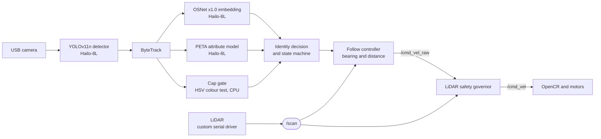

# The Carry My Bag Robot

A TurtleBot3 that carries a user's bag and follows them indoors, using only a camera and a
LiDAR, with every model running on a Raspberry Pi 5 and a Hailo-8L accelerator. Detecting a
person is a solved problem. Knowing *which* person to follow is not, especially when the
people around the user are dressed almost exactly like them. This project is about that
second problem: the robot keeps hold of one registered person through occlusions and
look-alike bystanders by combining appearance re-identification with a simple, explicit
identity marker.

Senior capstone project, Abu Dhabi University, 2025-26.

## Demo

> Video and GIF to be added.

## The problem and what we found

The robot follows the user from behind, so it mostly sees their back. In our test
environment many people wear white kandooras, and from behind two people in white
kandooras look very similar.

Our first identity system used appearance re-identification only: an OSNet x1.0 embedding,
fused with a pedestrian attribute vector, compared against a reference captured when the
user registered. It worked until someone similar walked between the robot and the user.
The tracker would briefly lose the user, re-identification would pick the most similar
person in view, and that was often the wrong one. Once the lock moved, it stayed moved.

Our reading of why: the OSNet model we deployed was trained on Market-1501, a dataset of
pedestrians filmed by campus surveillance cameras. In that kind of data, clothing colour
and shape are what separate most people, so the embedding leans heavily on them. Two
people in the same white kandoora, seen from behind, give it very little else to use.

**The fix.** The user wears a bright orange cap. For every tracked person we measure the
fraction of orange pixels (HSV threshold) in the top 16% of their bounding box, which is
roughly the head. A score of 0.025 or more counts as wearing the cap. When the cap is
visible:

- only the person wearing it can become, or stay, the target. This is a hard veto, so a
  look-alike cannot win on appearance score;
- the check runs on every frame while following, not only when re-acquiring. If the lock
  ever moves to someone else, it moves back within two frames.

When the cap is not visible, for example when the user turns around, the robot falls back
to appearance plus attributes.

**Limitations, stated plainly.**

- The identity guarantee depends on the user wearing the cap and the cap being visible.
- The detector checks a colour, not a specific object. Any orange in the head region counts,
  so two people in orange caps would both pass the gate.
- The colour threshold was tuned under our indoor lighting and may need re-tuning elsewhere.
- Tested indoors with one user at a time.

## Architecture



- **Detection and tracking:** YOLOv11n on the Hailo-8L, with ByteTrack keeping track IDs
  stable across frames.
- **Re-identification:** an OSNet x1.0 embedding (512-d) and a 35-attribute PETA vector,
  combined as 0.6 x appearance + 0.4 x attributes and compared with a reference that is
  captured from several views during registration and never updated afterwards, so a wrong
  match cannot drift the reference.
- **Occlusion handling:** when the user is lost, people who were visible at that moment are
  treated as the likely occluders and excluded from re-acquisition.
- **State machine:** idle, registering, identification, following, blind chase, suspended,
  re-identification. The robot only drives while following, plus a short decaying coast
  after losing the user.
- **Follow controller:** turns toward the user's bounding box and holds a distance of 2.0 to
  2.3 m, measured with the LiDAR along the user's bearing.
- **Safety governor:** a separate ROS 2 node that watches a ±30° cone in front of the robot,
  scales forward speed down below 0.60 m and stops it below 0.30 m. It never steers.

More detail, including file-by-file notes, is in [docs/ARCHITECTURE.md](docs/ARCHITECTURE.md).

## Hardware and software

| Component | Detail |
|---|---|
| Robot base | TurtleBot3 Burger with OpenCR. Stock wheels replaced with 113 mm wheels for higher top speed |
| Computer | Raspberry Pi 5, Ubuntu 24.04 |
| Accelerator | Hailo-8L AI HAT (13 TOPS), HailoRT 4.20.0 |
| Camera | UGREEN USB webcam |
| LiDAR | LDROBOT 360° LiDAR (LDS-02 form factor) |
| Middleware | ROS 2 Jazzy, CycloneDDS |
| Models | YOLOv11n, OSNet x1.0, person_attr_resnet_v1_18 (PETA), all as HEF files compiled for the Hailo-8L |

Everything runs on the robot. There is no laptop in the loop.

## Results

All numbers below were measured, but please read how before quoting them.

**On the robot.** These were read from the app's own on-screen telemetry while replaying
screen recordings of real runs, not from a per-frame log.

| Measure | Result |
|---|---|
| Perception loop rate (app FPS counter) | about 17.6 FPS on average, 16.4 to 18.0 observed |
| Cap score, person wearing the cap | 0.06 to 0.18 |
| Cap score, everyone else | 0.00 to 0.02 (threshold 0.025) |
| Wrong-person locks in about 10 min of multi-person runs (3 runs) | none confirmed; 1 frame was ambiguous |
| Recovery after a full occlusion (1 event) | back on the correct person after about 9 s |

**Offline ablation: re-identification with and without the cap gate.** The same recorded
video (6,307 frames, about 105 s, in which the cap was visible) was run through two identity
policies side by side: appearance re-identification only, and the same plus the cap gate.

| Measure | Re-ID only | With cap gate |
|---|---|---|
| Frames locked on the correct person | 58.6% | 81.5% |
| Frames locked on a different person | 32.6% | 4.1% |
| Sustained wrong locks (held 0.3 s or longer) | 12 | 4 |
| Longest wrong lock | 11.6 s | 0.6 s |
| Total time on the wrong person | 34.3 s | 4.3 s |

The cap gate cut time on the wrong person by about 87%. It did not reach zero. Caveats: this
ran offline on a single clip using desktop models (YOLO11n through Ultralytics, and OSNet
x1.0 with ImageNet weights rather than a re-ID checkpoint), without the attribute model,
and "correct person" is defined by the cap detector itself, which favours the cap policy.

## What we tried that did not work

- **MobileNetV3 for re-identification** on the first laptop prototype. It could not separate
  people in similar clothing. Replaced with YoutuReID, then with OSNet on the robot.
- **Running perception on a laptop** and sending commands to the robot over Wi-Fi. Replaced
  by running everything on the Pi and the Hailo-8L.
- **RepVGG-A0 re-identification on the Hailo.** Replaced with OSNet x1.0, which scores higher
  on Market-1501.
- **Checking the cap only when re-acquiring the user.** A look-alike crossing in front could
  take the lock while the cap was briefly hidden, and keep it. Checking every frame fixed it.
- **Detecting the cap's white number panel** as a second cue. White walls and white kandoora
  made it useless, so the gate uses orange only.
- **The stock LiDAR driver.** It opened the serial port at 230400 baud, but this unit talks at
  115200, so `/scan` stayed empty with no error. We wrote our own driver. The standard
  checksum also rejected about 96% of valid packets on this unit, so it checks packet
  structure instead.

We also considered RF-DETR (a transformer detector) and a UWB radio tag. We did not adopt
RF-DETR because it improves detection, not identity, and fits the Hailo-8L poorly. A UWB tag
would identify the user without needing line of sight, but needs radio hardware the Pi does
not have.

## How to run it

**Tested on:** Raspberry Pi 5 with Ubuntu 24.04 (kernel 6.8 raspi), ROS 2 Jazzy,
HailoRT 4.20.0, TurtleBot3 Burger. The laptop demo was run on macOS with Python 3.13.

### On the robot

1. Install ROS 2 Jazzy and the TurtleBot3 packages, with `TURTLEBOT3_MODEL=burger`.
2. Install HailoRT 4.20.0, its PCIe driver and its Python bindings from the Hailo SDK, into
   a virtual environment. After an Ubuntu kernel update the driver must be rebuilt for the
   new kernel, otherwise the camera feed stays black:
   ```bash
   sudo apt install linux-headers-$(uname -r)
   sudo dkms install hailo_pci/4.20.0 -k $(uname -r)
   ```
3. Models. The three HEF files are not in this repository: `yolov11n.hef`,
   `osnet_x1_0.hef` and `person_attr_resnet_v1_18.hef`, each built for the `hailo8l` target.
   All three are Hailo Model Zoo architectures; any that are not available precompiled for
   `hailo8l` can be compiled with the Hailo Dataflow Compiler. The code currently expects
   them in `/home/capstone/hailo_demo/models/`.
4. Copy the files in `deploy/` to the robot's home directory. `deploy/robot_v3.sh` expects
   them there and runs the perception code from `~/capstone-robot-follow-cap`.
5. Start everything inside tmux. The launcher stops all services when its terminal closes, so
   a plain SSH session that drops will stop the robot:
   ```bash
   tmux new -s robot 'bash ~/robot_v3.sh'
   ```
6. Open `http://<robot-ip>:5000`, click the person wearing the cap, and have them turn slowly
   for a few seconds so the robot captures several views.

### On a laptop (no robot)

This runs the earlier pipeline (no cap gate, YoutuReID on the CPU) on a webcam:

```bash
pip install -r requirements.txt
python scripts/download_weights.py
python scripts/run_perception.py
```

### Known issues

- The LiDAR driver and the camera use opposite angle conventions. In
  `run_perception_hailo_v3.py` the camera bearing goes to the LiDAR lookup without being
  negated, so when the user is off to one side, the follow distance is read from the other
  side. It is correct when the user is straight ahead. A fix was made on the robot later but
  never committed, and we cannot test a change without the robot.
- `deploy/safety_node.py` republishes the last command it received at 30 Hz with no timeout.
  If the upstream stops sending, the robot keeps its last velocity until the node is stopped.
- Model paths and the launcher's working directory are hardcoded for our robot.
- `deploy/robot_v2.sh` points to a script that is not in this repository.

## Repository layout

```
perception/
  pipeline_v2.py       identity state machine with the cap gate (used on the robot)
  pipeline.py          earlier state machine without the cap gate (laptop demo)
  cap_detector.py      orange-cap HSV detector
  detector/            YOLO wrappers; hailo_yolo.py is the robot's detector
  tracker/             ByteTrack wrappers; hailo_yolo_tracker.py is the robot's tracker
  reid/                hailo_osnet.py, hailo_attributes.py (robot); osnet_reid.py (laptop)
  occlusion/           occlusion memory
scripts/
  run_perception_hailo_v3.py   robot entry point (cap gate, web UI, controller)
  run_perception_hailo.py      earlier robot entry point, before the cap gate
  run_perception.py            laptop webcam demo
  download_weights.py          downloads the laptop re-ID weights
deploy/
  robot_v3.sh          starts the full robot stack
  lidar_serial_scan.py our LiDAR driver (115200 baud)
  safety_node.py       LiDAR safety governor
  cmd_vel_relay.py     forwards perception velocity commands into ROS 2
  lidar_bridge.py      forwards /scan to the perception process
ros2_ws/               the first prototype's ROS 2 package (laptop over Wi-Fi), kept for history
docs/ARCHITECTURE.md   design notes
docs/media/            README demo GIF
```

## License

MIT. See [LICENSE](LICENSE).
